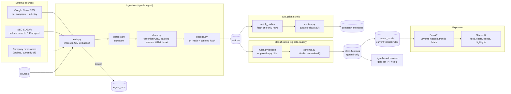

# Architecture

## 1. Flow

Everything runs from one image: `api`, `web` and `worker` are the same
`signals` package with different entrypoints (`docker-compose.yml` anchors this
as `x-app`).

## 2. Tables

| table | grain | why it exists |
| --- | --- | --- |
| `companies` | organisation | 5 OEMs + 12 Tier-1 vendors; `aliases` drive the entity tagger |
| `supply_links` | (vendor, customer, segment) | the mapping sheet deliverable, served as `/companies/supply-map` |
| `sources` | one fetchable feed | URL + parser + `query` (CSS selector or search query), plus `last_error` / `last_success_at` so a broken feed is visible without logs |
| `articles` | one document | canonical `url`, `url_hash`, `content_hash`, `clean_text`, `published_at` (UTC), `fetched_at`, `needs_enrichment` |
| `company_mentions` | (article, company) | resolved entities with `mention_count` - the join that makes "news about ZF" a query |
| `classifications` | (article, prompt_version, model) | **append-only** verdict history; keeps model versions comparable instead of overwriting each other |
| `event_labels` | (article, category) | flat, indexed projection of the *current* best verdict - the only table the API filters on |
| `ingest_runs` | one job pass | ledger of seen/new/failure counts per stage; the operational audit trail |
| `validation_labels` | (article, category) | hand-labelled gold set the metrics come from |

Indexes: `articles(published_at)`, `articles(content_hash)`,
`event_labels(category)`, and unique keys on `articles(url_hash)`,
`classifications(article_id, prompt_version, model)`,
`sources(url, kind)`, `company_mentions(article_id, company_id)`,
`validation_labels(article_id)`. There are deliberately no JSON operators or
dialect-specific expressions: `classifications.categories` is read in Python, and
date bucketing happens in Python too, so the same code runs on SQLite and
PostgreSQL.

## 3. Invariants the code enforces

These are the rules that were learned the hard way; each has a test.

1. **A source failure never kills the job.** `collect_source` catches everything,
   writes `sources.last_error` and the run ledger records `partial`
   ([tests/test_pipeline.py:84](../tests/test_pipeline.py)).
2. **Ingestion is idempotent.** Canonical URL + content hash mean a re-run of the
   same feed inserts nothing.
3. **Timestamps are never invented.** `MIN_PLAUSIBLE = 1990` clamps epoch/template
   dates to the fetch time, but a genuine 2010 article keeps its own date; when an
   article is dated by fetch alone, `enrich_bodies` replaces it with the date the
   page declares in `article:published_time` / `<time datetime>`
   ([tests/test_enrich.py](../tests/test_enrich.py)).
4. **A `&`-label is not a category.** `Verdict.normalized()` maps every spelling
   ("Technology & Innovation", "regulation", "investing") onto the four canonical
   keys, drops unknown labels and sub-0.2 confidences, and keeps the strongest
   score per category ([src/signals/classify/schema.py](../src/signals/classify/schema.py)).
5. **Re-tagging follows enrichment.** An article whose body arrives later must be
   reconsidered, so `run_etl` unions the untagged set with the ids it just
   enriched (`or_(id.not_in(tagged), id.in_(enriched_ids))`).
6. **A title-only row is never classified blind.** SEC and newsroom parsers index
   a headline and set `needs_enrichment`; `enrich_bodies` fetches the page, keeps
   only text over 250 characters (a cookie wall is not a body), leaves the flag set
   when the fetch fails so the next pass retries, and bounds itself to 40 rows per
   pass so one slow host cannot stall ETL.
7. **`event_labels` is derived, never written directly.** `refresh_event_labels`
   rebuilds it from the highest-confidence verdict per article after every
   classification pass, so a new model version replaces the queryable view without
   destroying the history it came from.
8. **Stages flush; callers commit.** `run_ingestion` / `run_etl` /
   `run_classification` never call `commit()` - `session_scope()`, the CLI and the
   worker own the transaction.
9. **Acronym matching is case-sensitive.** `ZF`, `FAG`, `DAF` must not fire inside
   lowercase prose, so aliases keep their original casing and terms of five
   characters or fewer require exact case
   ([src/signals/db/models.py](../src/signals/db/models.py), `Company.match_terms`).

## 4. Classification stage

Two interchangeable providers behind one interface:

- `rules.py` - deterministic lexicon, whole-word patterns with light inflection
  (`(?:s|es|ed|d|ing)?`), confidence from lexical density
  (`base + 0.13 * hits`, capped at 0.9), plus a source-kind boost that makes
  `regulator` sources lean towards Compliance & Regulation. Runs offline, so the
  deployed app has no key dependency and the baseline is reproducible.
- `provider.py` - any OpenAI-compatible chat endpoint with a JSON-object response,
  temperature 0, and the same `Verdict` validation. Used when
  `LLM_PROVIDER=openai`.

Both write `classifications` rows tagged with `model` and `prompt_version`, and
`signals.eval.harness score --model <name>` compares them on the same gold set.

## 5. Exposure

- `api/queries.py` holds every query; `api/app.py` only does HTTP concerns
  (validation ranges, 422 guards, CORS, optional `X-API-Key` middleware, OpenAPI).
- `web/app.py` talks to the API over `httpx` and never imports the DB layer, so
  the dashboard and the API can be deployed separately - and the dashboard cannot
  accidentally become a second source of truth.
- `worker.py` is ingest + ETL + classify on intervals; its liveness signal is
  `/runs`, not a `/healthz` echo.

One contract worth stating because it surprises people: `/events` counts rows that
have a *verdict*, while `category=` intersects the `event_labels` index. A
classifier that found no category above the 0.2 floor still stores a verdict (that
is the measurable negative), so `/events` totals are larger than any single
category filter - currently 979 verdicts against 436 labelled articles.

## 6. Failure modes and what happens

| failure | behaviour |
| --- | --- |
| feed 5xx / timeout | 3 retries with exponential backoff, then `sources.last_error`, run `partial` |
| newsroom layout change | parser yields 0 items, run still `success` - caught by `probe_sources` and by the ledger's `items_seen` |
| LLM returns prose instead of JSON | `extract_json` tolerates code fences; an unparsable verdict is discarded, the article stays unlabelled |
| duplicate wire copy | collapsed on `content_hash` after boilerplate stripping |
| DB unavailable at boot | `entrypoint.sh` retries `alembic upgrade head` 20 times before starting the app |
| worker restart | everything resumes from table state; the ledger is the only mutable history |
